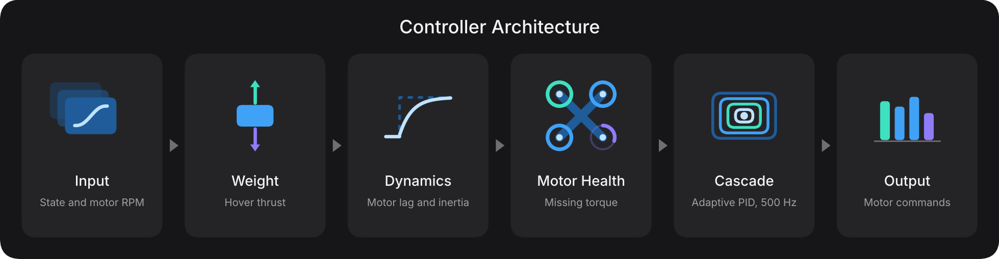
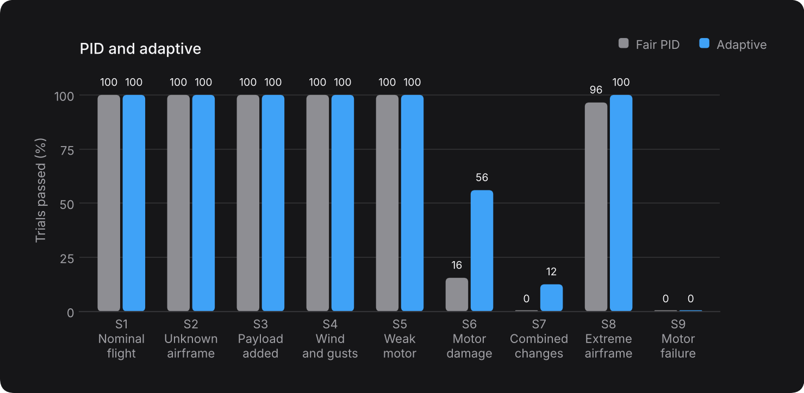

# Adaptive Flight Control


Adaptive Flight Control flies a compact quadrotor whose body changes in ways it cannot measure directly: a different frame, a new payload, slower motors, a weak motor. It is the cascaded PID that flight stacks such as PX4 already fly, made adaptive in the three places where fixed gains were measured to fail, and it reports what it has learned about the drone as it flies. Everyday flight stays the tuned PID. On a 220 mm, 500 g quadrotor in simulation, it matches a fair PID on every everyday scenario, flies every trial of an airframe beyond its tuning range where the PID loses 4 %, and holds position after a motor is damaged in 56 % of trials against 16 %.

## How It Works



**Input.** Position, velocity, attitude and body rate from the host's state estimator, and the RPM of each motor from bidirectional DShot, 500 times a second.

**Weight.** Hover-thrust estimation, as PX4 runs it, compares the thrust commanded with the vertical acceleration that follows and updates the mass the cascade believes. It only updates near level, where the reading is reliable.

**Dynamics.** Two estimators read motor RPM and the gyro, each a least-squares fit whose old measurements fade over two seconds. The first finds each drone's motor lag from how fast the measured speed closes on the command. The second finds how strongly each motor turns each axis and takes the median of the four, so a weak motor cannot bias the inertia that the torque commands are scaled by.

**Motor health.** From the measured RPM the controller knows the roll and pitch torque the motors should produce, and from the gyro the torque they actually produce. A steady gap is torque that has gone missing. Each motor sits on its own diagonal, so the direction of the gap names the motor and its size gives the thrust it has left.

**Cascade.** Position sets a velocity, velocity an acceleration, the acceleration an attitude, the attitude a body rate, and the rate loop the torques a mixer turns into motor thrusts, giving up yaw first when the motors run out of room. The estimated mass and inertia scale the commands. Once the motors are slower than the gains were tuned for, the attitude and rate gains are slowed by the same ratio.

**Output.** Four normalised motor commands, and a readout of mass, motor lag, inertia and the health of each motor.

## Where It Fits

The controller is designed for a small multirotor that is flown in many configurations, carries changing payloads and ages in service, on a flight controller that already runs a cascaded PID. Each part of the design answers one feature of that situation.

| The situation | The design |
| :-- | :-- |
| A tuned cascaded PID already flies the drone well when nothing has changed | Every everyday flight stays that PID, and adaptation acts only on what has changed |
| Payload and battery change the weight from one flight to the next, or in the middle of one | Hover-thrust estimation keeps the thrust command matched to the weight |
| Frames, propellers and motors are swapped, so inertia and motor response drift from the tuning | Inertia and motor lag are estimated in flight, and the inner loops are slowed to keep the tuned margin |
| Motors wear, chip a propeller or overheat, and lose thrust without warning | Motor health is read from missing torque, motor by motor, with no extra sensor |
| ESCs report motor RPM, and the flight controller has a few hundred microseconds per tick | Every estimator is a small closed-form fit on RPM and the gyro, with no learned model |

Some situations need a different design. A motor that fails completely (S9) is outside the envelope. With one motor off, its diagonal partner has to idle too, and only a controlled spin about the yaw axis can keep the drone upright. A cascade cannot fly that, so failure detection and the three-motor landing are built but switched off, and neither controller lands any S9 trial. A motor left with 20 to 40 % of its thrust (S6, S7) sits at the edge of the envelope.

## How It Performs

Every scenario of [docs/requirements.md](docs/requirements.md) is flown as 200 randomised trials with fixed seeds. The adaptive controller is compared against a fair PID, the same cascade with fixed gains, hover-thrust estimation and a rate-loop integral, tuned on the nominal drone with a margin for motors twice as slow. In the everyday scenarios, S1 to S5, the fair PID already meets every target, so the adaptive controller is held to no regression. The hard scenarios, S6 to S9, lie past what fixed gains handle.

<p>
  
  <br>
  <sub><b>PID and adaptive.</b> The share of 200 trials that meet each scenario's target, for the fair PID (grey) and the adaptive controller (blue). In the everyday scenarios S1 to S5 both pass every trial. In S6 and S7 a motor is damaged, alone and with a 30 % payload in wind, and a trial passes when the drone holds within 0.3 m of hover. S8 is an airframe beyond the tuning range, with mass ±45 %, inertia ±60 %, motor constants ±30 % and motor lag up to 60 ms, where the adaptive controller passes every trial against 96 %. S9, a motor failing completely, is outside the envelope.</sub>
</p>

| Scenario | Fair PID | Adaptive |
| :-- | --: | --: |
| S1, nominal figure-eight at 2 m/s, median tracking error | 0.016 m | 0.016 m |
| S5, one motor weakened to 60 % thrust, median distance from hover | 0.090 m | 0.069 m |
| S6, one motor left with 20 to 40 % thrust, trials held within 0.3 m | 16 % | 56 % |
| S7, damaged motor, 30 % payload and wind up to 8 m/s, trials held within 0.3 m | 0 % | 13 % |
| S8, extreme airframe, tracking error at the 95th percentile | 0.132 m | 0.030 m |

On everyday flight the two controllers agree to the millimetre, because adaptation only acts where the drone has changed. The clearest gain is at the tail of S8. Motors up to 60 ms slow leave the fixed gains with too little phase margin, and slowing the inner loops to match the measured lag keeps the margin the tuning was built with.

### Condition Readout

The estimators are read at the end of each flight and compared with the drone the simulator flew, over the same 200 trials.

| Quantity | How it is read | Accuracy |
| :-- | :-- | :-- |
| Mass | Hover thrust, after a 30 % payload is added mid-hover (S3) | 0.02 % median error, every trial within 10 % |
| Mass | Hover thrust, on an unknown airframe with motor constants ±20 % (S2) | 10.2 % median error, 49 % of trials within 10 % |
| Motor lag | Fit of RPM against command, true lag 10 to 40 ms (S2) | 0.76 ms median error, every trial within 5 ms |
| Inertia | Fit of RPM against gyro, inertia ±40 % (S2) | Yaw 10 %, pitch 19 % and roll 136 % median error |
| Motor health | Missing torque, one motor weakened to 60 % (S5) | 0.01 points median error, every trial within 10 points |
| Motor health | Missing torque, one motor left with 20 to 40 % (S6) | 0.02 points median error, 85 % of trials within 10 points |

Hover thrust is measured through the motors, so what it finds exactly, to 0.01 %, is mass in units of their thrust. That is the quantity the cascade needs to command. Read as kilograms, it carries the motor-constant error the controller cannot see. Inertia is read well enough on yaw, roughly on pitch, and not on roll. The motor-health errors in S6 come from the trials where the drone was already lost.

## Engineering Decisions

### An adaptive PID, not a learned policy

The first plan replaced the PID with a learned policy. A teacher policy trained with reinforcement learning flew far worse than the fair PID, and measuring the PID showed that it fails in only three specific ways, weight, slow dynamics and a failing motor. The controller keeps the PID and adapts it in exactly those three ways, so every other flight is the behaviour a tuned stack is already trusted with.

### A fair baseline first

Against a PID without hover-thrust estimation or a rate integral, adaptation looked like a large win. Once the baseline had what PX4 ships, it met every everyday target in every trial. The everyday scenarios are therefore held to no regression, and the hard scenarios were added where fixed gains were measured to fail.

### Slowing the loops, not retuning them

Slow motors add delay, and delay is what erodes a tuned loop's margin. Rather than search for new gains in flight, the controller scales the attitude and rate gains by the ratio of the lag the gains were tuned for, 45 ms, to the measured one. This keeps the margin of the original tuning with a single number per drone.

## How It Was Tuned

The gains are tuned once, on the nominal drone, the way a PID is commissioned. 512 gain sets fly side by side on the nominal figure-eight and a step, and a set is kept only if it still flies the step cleanly with motors twice as slow as nominal. The best set tracks the figure-eight to 0.016 m RMS. Nothing about payloads, wind or motor faults is seen in tuning, and the adaptive controller starts from the same gains.

## How to Use It

The controller is `src/control/adaptive.py`, with its estimators beside it in `src/control/`, and the simulator in `src/plant/`. Running it needs NumPy, PyTorch and Matplotlib. The model card, `models/model.json`, records the vehicle, gains, estimator settings and results.

### Installation

```bash
git clone https://github.com/iamabdirazak/adaptive-flight-control.git
cd adaptive-flight-control
python3 -m venv .venv && source .venv/bin/activate
pip install -e ".[test]"
python -m pytest -q
```

### Flying a Drone

```python
import torch
from src.control.adaptive import Adaptive
from src.plant.quadrotor import Quadrotor
from src.plant.vehicle import Vehicle

vehicle = Vehicle()
drone = Quadrotor(vehicle, 1)                        # or many drones, one row each
drone.reset(torch.tensor([[0.0, 0.0, -2.0]]))        # NED, 2 m up
controller = Adaptive(vehicle, 1)
controller.drone = drone                             # the source of motor RPM

target, heading = torch.tensor([[1.0, 0.0, -2.0]]), torch.zeros(1)
for _ in range(1000):                                # 2 s at 500 Hz
    state = (drone.position, drone.velocity, drone.attitude, drone.rate)
    command = controller(state, target, heading, 0.002)
    for _ in range(4):                               # physics at 2 kHz
        drone.step(command, 0.0005)

controller.mass, controller.lag.estimate, controller.inertia, controller.fault.health
```

### Reproducing the Results

```bash
python -m src.evaluation.validation
python -m src.evaluation.tune
python -m src.evaluation.baseline
python -m src.evaluation.baseline adaptive
python -m src.evaluation.readout
python -m src.evaluation.comparison
python -m src.visualization.diagrams
```

Everything runs on a CPU. Each study of 9 scenarios and 200 trials takes a few minutes.

## Limitations

- Tested in simulation only. The vehicle values are first estimates for a 5-inch drone, and the C library, the compute budget and the hardware are not yet built or measured.
- A complete motor failure is not handled (see Where It Fits).
- Roll inertia is not estimated reliably, and mass in kilograms is only as good as the motor constants.
- Wind is not estimated, so the readout does not report it.
- Loss of RPM telemetry (S10) and the guard with its fallback (S11) are not built.

## License

The code is released under the MIT License.

## Author

Abdirazak Mubarak, November 2026
